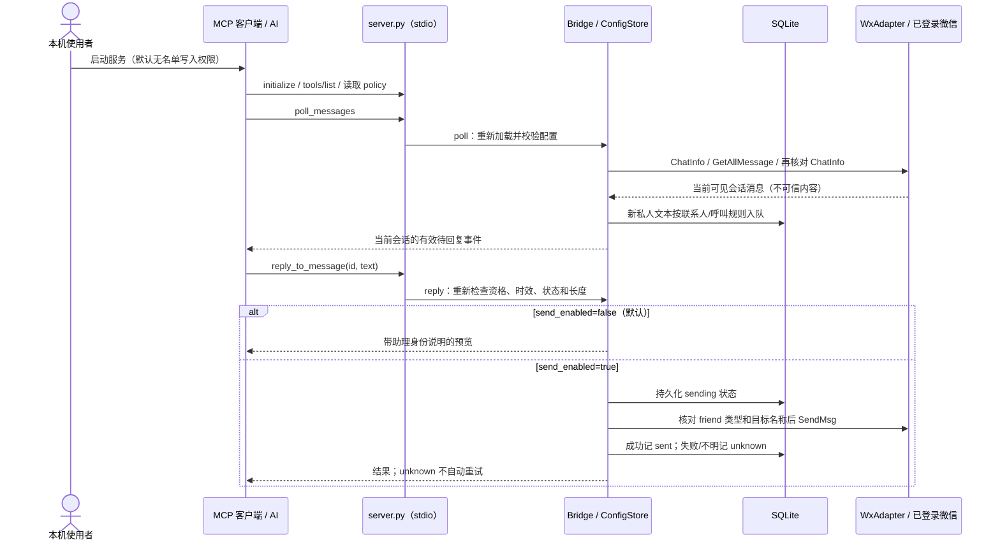

# 认证、权限与凭据处理

审查日期：2026-10-10。本说明依据仓库自有源码；不代表已审计微信客户端或第三方二进制。

## 认证模型

本项目复用使用者在 Windows 微信客户端中建立的登录会话。服务不实现微信登录、
MCP 用户登录或独立所有者认证。默认仅以 stdio 运行，没有 HTTP 监听、Bearer token
验证、OAuth 回调或远程登录端点。

能以该 Windows 用户身份启动服务、连接其管道或修改本地文件的程序属于信任边界。
stdio 传输本身不验证微信号主人身份。微信备注名和消息中的 `Codex` 只是回复资格规则，
不是身份认证；数据库消息 `id` 只是查找键，不是秘密或访问 token。

## 组件及责任

| 组件 | 代码入口 | 责任与边界 |
|---|---|---|
| 微信桌面客户端 | 用户在微信中登录 | 持有真实微信登录会话；本服务不负责创建、刷新或注销它 |
| MCP 入口 | [server.py](../server.py)：`main` | 创建 FastMCP，以 `mcp.run(transport="stdio")` 服务本机客户端；启动参数控制是否注册名单写入工具 |
| 规则与队列 | [bridge.py](../bridge.py)：`Bridge` | 过滤会话、消息来源和回复资格；检查时效、状态、长度、发送开关与频率；不认证 MCP 调用者 |
| 微信适配器 | [bridge.py](../bridge.py)：`WxAdapter` | 通过 wxauto4 操作已经登录的 UI；`IsOnline` 检查在线状态，不验证当前账号就是预期主人 |
| 数据库读取器 | [database_reader.py](../database_reader.py)：`WcdbReader` | 明确选择 DLL 和数据库；账号目录/会话绑定、只调用读取接口，不认证实际登录者 |
| 本机数据库凭据 | [local_credentials.py](../local_credentials.py) | 交互录入、当前 Windows 用户 DPAPI 加密、账号路径作为附加绑定；不通过 MCP 传递 |
| 配置存储 | [settings.py](../settings.py)：`ConfigStore` | 校验 JSON、串行读写、原子替换；依赖操作系统文件权限，不使用密码或签名 |
| 进程锁与 SQLite | `FileLock`、`Bridge.__init__` | 同库单实例和发送状态恢复；锁只解决并发，不代表账号身份或授权 |
| AI 客户端与策略 | `RULES`、`wechat://policy` | 判断是否需要回复、避免承诺和跨会话披露；这些语义要求仍依赖客户端遵守策略 |

## 请求流程



首次轮询只建立历史基线，不将历史快照新增入队。`reply` 会重新加载配置，所以移除
联系人可以撤销普通待回复消息的资格。发送开关是本机设置，不是逐条消息审批。
发前名称核对与发送之间仍有 UI 切换竞态，且没有稳定联系人或账号 ID 校验。

## 联系人管理权限（0.3.0）

默认服务只注册五个工具：`wechat_status`、`get_reply_contacts`、`poll_messages`、
`reply_to_message`、`dismiss_message`。`set_reply_contacts` 默认不注册，直接调用
`Bridge.set_contacts` 也会在写入前抛出 `PermissionError`。

日常修改名单可以由本机使用者使用 `--set-contacts` 或 `configure-contacts.ps1`；
运行中的服务在下一次工具调用加载。只有在信任 MCP 客户端并确实需要它管理名单时，
才在服务启动参数中加入 `--allow-contact-management`，重启后开放第六个工具。
例如，将生成的 MCP 配置中的 `args` 改为：

```toml
args = ["C:/path/to/wechat-codex-mcp/server.py", "--allow-contact-management"]
```

这是启动时的能力授权，不是密码认证。它不会验证哪条调用来自主人；显式开放后，
同一 MCP 客户端仍可修改名单。微信消息、MCP 工具参数以及 `config.json` 中添加
`allow_contact_management` 字段都不能给当前服务授予该能力。必须改变启动参数并重启。

`wechat_status.permissions` 显示 `transport="stdio"`、`owner_authentication=false`
以及当前 `mcp_contact_management` 值；即使显式开放写入，也不会声称已认证所有者。
该保护仅覆盖本服务工具；拥有 shell、文件写入或重启权限的本机客户端仍能绕过它。

## 凭据与 token 的生命周期

| 对象 | 本仓库如何处理 |
|---|---|
| 微信密码、扫码登录及登录 token | 自有源码没有专门索取、提取登录凭据的逻辑；用户在微信中登录，登录过期需在微信中处理 |
| MCP 访问/刷新 token | 没有发行、验证、轮换、刷新或撤销流程；当前 stdio 服务没有独立认证层 |
| 模型 API Key | 服务不调用模型 API，不需要或保存模型密钥；模型及其认证由外部 MCP 客户端负责 |
| GitHub 凭据 | 应用运行时不访问 GitHub；开发同步使用的 Git/连接器凭据不属于桥接配置，也不应写入仓库 |
| 数据库解密密钥 | 使用者在本机 `--store-database-key` 不回显录入；不提取现有软件凭据；保存在独立 .dpapi 文件，绑定当前 Windows 用户及账号规范路径 |
| `config.json` | 本地明文联系人名单、文案、发送开关及运行设置，不是 token 存储 |
| `state.sqlite3` | 本地明文保存符合规则的消息正文、回复和处理状态，不设凭据字段；消息若包含密码或 token 也会作为文本保存，过期不删除正文 |
| 数据库状态文件 | 保存配置账号/入口的摘要绑定、分来源已见身份、对账时间、授权正文及预览草稿；正文仍为明文，不存数据库密钥 |
| `codex-mcp.toml` | 生成的本机程序路径和启动参数，不含本项目认证 token |

MCP SDK 依赖中存在认证相关库，并不意味着本项目启用了认证。wxauto4 固定版本包含
第三方二进制，自有源码无法证明这些二进制内部如何处理登录数据或联网。
适配器关闭文件日志，并在第三方提供开关时关闭 telemetry；这不是完整依赖审计。

本地运行文件、数据库、日志、`.env` 和虚拟环境由 [.gitignore](../.gitignore) 排除。
gitignore 不提供加密或访问控制，也不能保护被改名、放到任意路径或强制加入 Git 的文件。

## 验证与尚未实现的边界

自动测试使用 MockAdapter、合成读取器和合成 ctypes 回调。核心测试证明默认 Bridge 拒绝名单写入且不改变配置或队列，
热加载配置不能开放管理能力；真实 MCP 子进程测试证明默认 `tools/list` 不包含写入工具，
猜测工具名调用也不能写入。显式启动参数开放后的修改、清空和输入校验有单独协议测试。

DPAPI 用人工生成的测试密钥验证往返与账号路径绑定，不涉及真实密钥。
密钥只在打开原生句柄时解密，传入 DLL 后清零临时 ctypes 缓冲；Python 和第三方内部内存副本不保证全部清除。
替换密钥需重启，删除文件不撤销现存句柄；同一 Windows 用户仍能解密，不能替代所有者认证。
数据库来源即使开启发送开关也只能保存预览；具体运行边界见 [DATABASE_READER.md](DATABASE_READER.md)。

这些证据不能证明真实微信兼容、原生账号身份或第三方凭据处理安全。独立所有者认证、
账号级互斥、数据库加密与留存清理仍未实现。默认关闭名单写入也不能消除回复内容中的
提示注入风险。详细状态见 [STATUS.md](STATUS.md)，本地数据边界见 [SECURITY.md](../SECURITY.md)。
